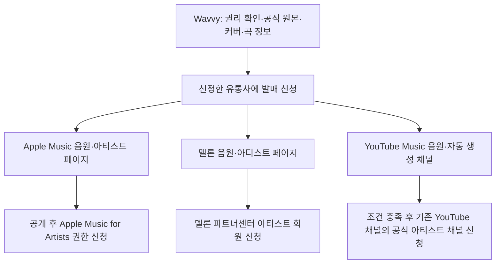

# Wavvy 음원 유통 리서치와 첫 발매 계획

TLDR; Wavvy의 개별 곡을 유통사(여러 음악 서비스에 음원을 전달하는 업체) 한 곳을 통해 Apple Music·멜론·YouTube Music에 발매한 뒤, 각 서비스의 아티스트 관리 권한을 신청한다. 실행을 시작하면 에이전트가 Aside MCP(브라우저를 제어하는 연결 도구)·REPL(명령으로 브라우저를 조작하는 환경)로 Google 로그인부터 가입·자료 준비·입력·업로드·신청까지 맡고, 젠은 곡·비용·계약 결정과 직접 필요한 인증만 맡는다.

- 상태: **Draft — 리서치·계획 작성 완료, 계정 개설·문의 발송·결제·계약·음원 제출 전**.
- 조사 기준일: 2026-10-27. 공개 공식 문서의 현재 내용을 비교했다. 인터넷 전체를 빠짐없이 조사했다는 뜻은 아니다.
- 목표: 세 서비스에서 **우리 Wavvy의 개별 음원과 별도 아티스트 페이지**가 검색되고 재생되는 것.
- 사용자 확정: 아티스트명 **Wavvy 유지**. 2026-10-27 질문 답변 원문: “Wavvy 유지 (추천: 현재 채널 브랜드와 통일)”.
- 첫 곡·발매일·유통사·지출은 아직 확정하지 않았다. 이 문서의 일정과 비용은 실행 제안이며 결제 승인이 아니다.
- 2026-10-27 추가 요청 반영: “구글 auth를 비롯해 네가 직접 할 수 있는 것들은 직접 할 수 있게 플랜이해줘. aside mcp나 repl 활용해서”. 현재 요청은 **계획 수정**이며 가입·발매 실행 시작 지시와 구별한다.
- 선례 없음(확인: `.ai/plans/`, `MASTER/`, `wavvy.md`의 음원 유통 관련 검색). 기존 브랜드·곡별 생성 기록·이미지·YouTube 채널은 재사용한다.

## 1. 계정과 유통의 순서

일반 청취 계정을 세 개 만든다고 곡을 업로드할 수 있는 것은 아니다. 유통사가 음원을 보내면 서비스가 곡과 아티스트 정보를 반영한다. 그 후 본인 확인을 거쳐 관리 권한을 받는다. Apple도 독립 아티스트에게 유통사를 통한 전달을 안내한다. [Apple 발매 안내](https://artists.apple.com/support/1108-get-your-next-release-on-apple-music)

| 서비스 | 발매 전 준비 | 발매 후 신청 | 완료를 확인할 증거 |
|---|---|---|---|
| Apple Music | Apple 계정, 유통사의 신규 Wavvy 페이지 요청 | 음악 공개 후 최소 **영업일 5일**이 지나면 Apple Music for Artists에서 접근 요청. 아티스트와의 관계·유통 정보 제출 | 음원 주소, 새 아티스트 번호, 접근 승인 화면 |
| 멜론 | 유통사에 아티스트 신규 등록 요청, 활동 소개·이미지 준비 | 파트너센터의 **아티스트 회원**으로 활동 증명·본명/활동명·연락처·동의서 등 제출. 소속사가 있으면 동의 필요 | 음원/아티스트 주소, 회원·관리 승인 |
| YouTube Music | 기존 `@wavvy24` 소유권·단일 Wavvy 아티스트 채널인지 확인 | 유통 후 Art Track(음원과 커버로 자동 생성되는 영상)·Topic(자동 생성 아티스트 채널) 확인. OAC(공식 아티스트 채널)는 유통사 등을 통해 별도 신청 | Music 음원 주소, Topic 주소. OAC 승인 여부는 별도 기록 |

출처: [Apple 관리 권한](https://artists.apple.com/support/1101-claim-your-account), [멜론 가입 지침](https://partner.melon.com/partrct/footer/guide/web/guide_dtlUseGuide.htm), [멜론 공식 FAQ](https://help.melon.com/web/faq/content.htm?faqId=QUES20140616000001), [YouTube Art Track](https://support.google.com/youtube/answer/6007071?hl=ko).

멜론 **Studio는 이번 음원 유통·아티스트 관리 가입 경로가 아니다**. 공식 파트너센터를 사용한다. [Melon Studio](https://studio.melon.com/)

Apple에는 이미 다른 Wavvy들이 있다. 이들의 기존 페이지를 우리 페이지로 선택하면 안 된다. 제출 시 **새 아티스트이며 기존 동명 페이지와 분리**해야 한다고 전달하고, 반영 후 이름이 아닌 고유 번호로 확인한다. 이름 유지 결정은 상표권 조사까지 마쳤다는 의미가 아니다. [동명 사례 1](https://music.apple.com/us/artist/wavvy/1458388839), [동명 사례 2](https://music.apple.com/us/artist/wavvy/1590755047)

## 2. 유통사 비교와 선택 기준

‘멜론을 지원한다’와 ‘우리 AI 곡을 멜론으로 접수한다’는 서로 다른 조건이다. 아래의 접수 가능은 최종 서비스 입점 보장이 아니다.

| 후보 | 세 서비스 전달 경로 | AI 음악 공개 정책 | 공개 비용·조건 | 이번 판단 |
|---|---|---|---|---|
| **KGMUSIC** | 국내 주요 서비스와 Apple·YouTube Music 명시 | 상업적 이용 권한이 있는 Suno Pro/Premier 곡 신청 명시 | Standard **앨범당 59,000원**, 월 구독 없음. 장기 계약 등 아래 확인 필요 | **국내 심사·한국어 지원을 우선할 때 1차 확인 후보** |
| **Too Lost** | Apple·YouTube Music 지원, 멜론 직접 제휴 발표 | AI 및 100% AI 곡도 심사 접수. 각 서비스의 거절 가능성 명시 | Artist **월 US$2.99 또는 연 US$19.99**. 구독 중 일반 음원 수익 배분 100%, 중단 후 음원 유지 선택 시 85% 안내 | **비용·계속 발매할 가능성을 고려한 최종 비교 후보**. AI 곡의 멜론 전달·한국 거주자 정산 확인 필요 |
| MusicSpray | 국내외 세 서비스 안내 | 사이트의 ‘AI 유통 도구’ 설명만으로 AI 곡의 멜론 접수는 확정할 수 없음 | 가입 99,000원, 앨범당 월 US$0.30 관리비. 아티스트 85% 안내 | 차선. 국내 발매 대기가 길고 AI 곡 조건 미확정 |
| RouteNote | 멜론 일반 지원 | **AI 생성·보조 곡은 한국 제휴 서비스에 전달하지 않는다고 명시** | 가격 비교에 앞서 목표와 충돌 | 이번 단일 유통사 경로에서 제외 |
| DistroKid | Apple·YouTube Music 확인. 공개 서비스 목록에서 멜론은 확인되지 않음 | 권리 보유·사칭 금지 등을 조건으로 AI 곡 허용 | 이번 목표를 충족하는 경로가 확인되지 않아 비용 비교 생략 | 해외 전용 대안. 멜론까지 된다고 가정하지 않음 |
| TuneCore | 이번 조사에서 우리 곡의 세 서비스 동시 경로 미확정 | AI 도구의 학습 자료가 전부 정식 허락된 모델이어야 함 | 우리 Suno 모델의 자격부터 확인 필요 | 기본안으로 선택하지 않음. Suno 전체 허용·금지로 단정하지 않음 |
| Sound Republica / SoundPress | 국내외 유통 서비스 안내 | Wavvy의 AI 곡 접수 조건·개별 계약은 공개 자료로 미확정 | 개별 견적·약정 확인 필요 | 앞의 두 후보가 불가할 때 확인할 업체 |

근거: [KGMUSIC 상품](https://www.konggmusic.com/price.php), [서비스](https://www.konggmusic.com/service.php), [Too Lost 요금](https://toolost.com/pricing), [AI 정책](https://help.toolost.com/hc/en-us/articles/42469065275924-Does-Too-Lost-Distribute-AI-Music), [멜론 직접 제휴](https://toolost.com/news/article/too-lost-announces-direct-partnership-with-melon-expanding-access-to-south-koreas-premier-music-market), [지원 서비스](https://toolost.com/), [MusicSpray 요금·일정](https://musicspray.net/faq.html), [배분](https://musicspray.net/musicdistribution.html), [RouteNote 한국 제한](https://support.routenote.com/kb-article/why-is-my-release-blocked-on-korean-stores/), [DistroKid AI](https://support.distrokid.com/hc/en-us/articles/41182362733715-Can-I-Upload-Music-Made-With-AI-Tools-to-DistroKid), [서비스 목록](https://support.distrokid.com/hc/en-us/articles/360013649093-Which-Services-and-Stores-Does-DistroKid-Send-Music-To), [TuneCore AI 기준](https://support.tunecore.com/hc/en-us/articles/46914166185236-TuneCore-s-GenAI-Music-Content-Framework), [Sound Republica](https://www.soundrepublica.com/), [SoundPress](https://sound-press.com/).

### KGMUSIC에서 특히 확인할 조건

아래는 공식 FAQ의 요약이며 실제 서명할 개별 계약서를 다시 읽어야 한다.

- Standard 정산 대상 수익의 아티스트 몫 80%. 소비자 결제액의 80%라는 뜻은 아니다.
- 최초 5년, 갱신 거절이 없으면 2년씩 연장. 중도 종료·이관 등 33,000원 안내가 있다.
- AI 심사 반려는 일부·전체 미입점이어도 원칙적으로 신청금 환불 대상이 아니다. 법령·회사 귀책 예외가 있다.
- 일반 발매 희망일은 신청일보다 최소 15일 뒤. 최종 일정은 심사에 따라 변한다.
- 정산 보고는 통상 2~3개월 지연. 누적 정산 가능액 50,000원부터 신청한다.
- YouTube Music을 유지하고 Content ID(다른 영상에서 음악을 찾아 권리를 주장하는 기능)만 제외할 수 있다. 신청 후 앨범 번호를 넣어 이메일로 요청하는 절차다. **전달 전 제외 확답**을 받아야 한다.
- OAC 자체 접수는 동일 아티스트의 Standard 이상 해외 발매 **앨범 2장**, 각각 발매 후 **10일 경과** 조건이다. Google의 최소 공식 발매 1개 조건과 구별한다.
- AI 활용·역할·기여를 사실대로 신고한다. 전부 AI가 만든 역할에는 `Suno AI` 표기가 가능하다고 안내하나, 이것이 AI의 법적 저작권을 인정한다는 뜻은 아니다.

출처: [KGMUSIC FAQ](https://www.konggmusic.com/faq.php). 홈페이지와 상세 OAC 안내가 다르면 결제 전 담당자에게 현행 조건을 확인한다.

**선택 규칙:** 우선 두 후보에 동일한 곡·제작 방식으로 사전 적격성 확인을 요청할 준비를 한다. 한국어 지원과 국내 처리 조건을 우선하면 KGMUSIC, 반복 발매 비용을 우선하면 Too Lost가 유리하다. 단, **AI 곡의 멜론 접수·실제 계약·정산 수령·Content ID 제외를 확인한 후보 중에서만** 선택한다. 공개 자료만으로 어느 한 곳의 최종 입점을 보장할 수 없으므로 지금 계약을 확정하지 않는다. 답변이 불명확하면 다른 서비스를 먼저 발매해 ‘세 곳 완료’라고 처리하지 않는다.

KGMUSIC의 저렴한 국내 전용 상품은 Apple Music 목표를 충족하지 않는다. 구독형은 해지 후 배분 조건이 건별 상품과 달라 단순히 한 달 요금만 비교하면 안 된다. [구독형 상품](https://www.konggmusic.com/subscription2.php)

## 3. 이번 프로젝트에서 가장 먼저 해결할 원본·권리 문제

**Suno의 현재 약관은 상업적 이용에 공식 다운로드를 요구하고, 녹음·스트림 추출을 금지한다.** 2026-09-03 시행 약관에서 확인했다. 과거 19:30 제작 때 브라우저 재생을 녹음한 경로는 이 조건을 놓쳤다. 그 녹음본을 이번 유통용 원본으로 사용하지 않는다. 승인된 공식 경로의 다운로드와 권리 증빙을 먼저 확보한다. [Suno 현행 약관](https://suno.com/terms), [9월 시행본](https://suno.com/terms-september-2026)

| 구분 | 확인된 사실 | 실행 전에 확보할 자료 |
|---|---|---|
| 생성·다운로드 권한 | 유료 요금제 권한에도 약관 조건이 적용됨. 공식 다운로드의 상업적 권한은 구독 종료 후에도 지속된다고 안내 | 곡 번호, 생성일, 당시 요금제·결제 증명, 공식 다운로드 완료·원본 |
| 다운로드 잔여량 | 공식 도움말은 Pro 월 20곡·Premier 60곡, 결제 주기 갱신과 추가 구매를 안내. 현재 Wavvy 계정 잔여량은 미조회 | 실제 계정의 이번 주기·남은 횟수·필요 비용 |
| 과거 무료 생성물 | 오래된 도움말의 ‘생성 당시 유료’ 기준과 현행 다운로드 약관을 함께 확인해야 함 | 첫 발매는 **유료 생성 및 공식 유료 다운로드가 모두 증명되는 곡**으로 한정. 예외는 Suno 확인 전 사용하지 않음 |
| 법적 저작권 | 유통 허가·서비스 입점과 법적 저작권 인정은 다름. AI 산출물 자체와 사람의 창작적 기여 부분을 구분해야 함 | 직접 쓴 가사·수정·구성 등 실제 기여 기록. 없는 기여를 만들지 않음 |

출처: [Suno 다운로드 정책](https://help.suno.com/en/articles/13614785), [다운로드와 사용 권한](https://help.suno.com/en/articles/9601665), [이전 소유권 안내](https://help.suno.com/en/articles/2410177), [한국 정부 2026-10-08 저작권 안내](https://www.korea.kr/briefing/pressReleaseView.do?newsId=156784631). 마지막 자료는 첨부 PDF 본문 2·7·8쪽까지 읽었다. 인간의 창작 기여가 있는 AI 활용 저작물은 등록 가능하며, 단순 지시만으로 기여가 자동 인정되는 것은 아니다.

‘머무르가 발매되어 있다’는 사실만으로 머무르 개별 곡의 저작권 등록·신탁 여부나 Wavvy의 입점 자격을 추정하지 않는다. 이번 조사에서 머무르의 권리 계약·등록 원부는 확보하지 않았다. Wavvy 곡에 대해서도 법적 저작권 전체를 인정받았다고 표시하지 않는다.

현재 19:30 선택 20곡의 생성·선택 번호와 제작 기록은 남아 있지만, 로컬 음원·완성 영상은 2026-10-26 사용자 요청으로 삭제됐다. `.ai/state.json`의 YouTube 게시 완료는 새 음악 서비스 유통용 원본 보유를 뜻하지 않는다.

근거 파일: [최신 정리 결과](../cleanup/2026-10-26-1930-final-media-cleanup-closeout.json), [곡 번호 기록](../../SERIES/19-30/production/suno-sequence-numbering-20261026.json), [제작 계약 기록](../../SERIES/19-30/production/final-premixed-audio.json), [채널 정체성](../../wavvy.md). 이 기록을 이용해 Suno의 같은 곡을 찾되, 실제 공식 다운로드 성공을 별도 확인한다. 다른 시리즈의 보관 WAV도 권리가 자동 확인된 것으로 간주하지 않는다.

## 4. 에이전트가 직접 수행하는 실행 계획

### 4.1 담당 범위와 실제 도구 확인

선례: 이 문서의 기존 단계별 유통 계획을 이어 쓴다. 첫 발매는 권리와 공식 다운로드가 확인되는 싱글 1곡을 권하며, 유통사 최종 후보 KGMUSIC·Too Lost 비교는 유지한다. 젠에게 가입 안내 목록을 넘기는 대신, 에이전트가 실제 화면에서 입력·제출하고 결과를 확인하는 방식으로 바꾼다.

**브라우저 지정 대조·실측(2026-10-27):** 사용자 지정은 Aside MCP 또는 REPL이다. 실제 호출은 `mcp__aside__browser_profiles`와 `mcp__aside__repl`이며, Aside 프로필 1개 연결·열린 탭 목록 읽기에 성공했다. 기존 Suno·YouTube Studio 탭이 있다. Aside `google-accounts` 스킬의 `googleAccounts.list()`도 성공했고 로그인된 Google 계정 3개를 확인했다. 이메일·이름·인증값은 문서에 기록하지 않았다. 이는 **연결·계정 조회 확인**이며 Wavvy에 쓸 계정 확정, 신규 서비스 로그인·동의·가입·업로드 성공을 뜻하지 않는다. 실행 시 다시 현재 화면을 확인한다.

| 작업 | 에이전트가 직접 할 일 | 젠이 필요한 때 |
|---|---|---|
| Google 로그인·기존 계정 | 기존 계정과 Wavvy 채널의 관계 확인, 계정 선택, 로그인 버튼·필요한 동의 처리, 돌아온 서비스의 로그인 상태 확인 | 여러 계정 중 Wavvy용 계정을 증거로 구별할 수 없을 때 한 번 선택. 기기 승인·직접 인증이 요구될 때 |
| 유통사·Apple·멜론 가입 | 기존 가입 여부 확인, 로그인·자동 완성, 무료 계정 가입과 확인 절차, 프로필·소개·공식 채널 입력 | 확인 가능한 자료에 없는 법적 정보가 필요하거나 직접 본인 확인이 요구될 때 |
| 곡·권리·제출 자료 | Suno 생성·구독·공식 다운로드 이력 대조, 원본 확보, 음원 검사, 커버·소개·역할·곡 정보 준비 | 첫 곡·실제 발매 버전 청음 확정. 추가 다운로드 구매 등 비용 발생 결정 |
| 문의·계약·결제 | 문의·첨부·계약 비교와 총액을 준비하고 실제 화면까지 입력. 발송 또는 지출·계약이 승인된 범위에서 직접 실행 | 문의 발송 지시가 아직 없으면 보낼 내용 준비 후 발송 결정. 유통사·금액·기간·갱신·최종 발매 내용 결정 |
| 업로드·발매 신청 | 음원·커버 첨부, 신규 Wavvy 페이지 요청, 세 서비스 선택, AI 활용 신고, Content ID 제외 확인, 승인된 내용 제출·보완 | 권리 진술·계약 내용에 새 결정이 필요할 때. 도구가 파일 선택을 처리하지 못하면 해당 선택 단계만 |
| 공개·관리 권한·정산 | 각 서비스의 실제 링크·곡·고유 번호·재생 확인, Apple·멜론 권한 신청, 조건 충족 시 OAC 신청, 보고서·지급 조건 확인 | 추가 서명·본인 인증, 증빙에 없는 사실 또는 새 비용이 생길 때 |

**인증을 일괄 수동 작업으로 넘기지 않는다.** 기존 로그인·화면에 제공되는 자동 완성을 먼저 사용한다. 직접 인증이 필요한 경우에는 정확한 서비스와 막힌 단계만 알려 젠이 그 화면에서 처리하도록 한다. 완료되면 에이전트가 같은 단계에서 이어 간다. 비밀번호·인증번호를 채팅으로 받거나 인증 자료를 Git에 남기지 않는다.

### 4.2 Google 로그인 진행 순서

1. Aside의 연결 프로필과 기존 탭을 확인한다. Google 계정 목록과 실제 Wavvy 채널 소유 화면을 대조해 사용할 계정을 정한다. 이메일의 이름만 보고 소유자를 추정하지 않는다. 계정이 불명확하면 선택만 젠에게 묻고 이후 같은 선택을 재사용한다.
2. 대상 서비스의 실제 화면에 **Google로 계속하기**가 있으면 에이전트가 누른다. Google 로그인이 없으면 해당 서비스가 제공하는 이메일·Apple 계정 등의 가입 경로를 사용한다. 세 서비스가 모두 Google 로그인을 제공한다고 가정하지 않는다.
3. OAuth(비밀번호를 다른 서비스에 넘기지 않고 Google 계정으로 로그인하는 절차) 창이나 새 탭에서 올바른 계정을 선택한다. 요청 권한·대상 서비스를 읽고, 승인된 로그인 작업에 필요한 기본 계정 정보 동의를 직접 진행한다. 별도 Gmail·Drive·YouTube 수정 권한까지 요구하면 작업에 필요한지 확인하고, 미승인 접근 확대라면 해당 부분만 젠에게 제시한다.
4. 비밀번호·패스키(기기에서 본인임을 확인하는 로그인 수단)는 화면에서 가능한 자동 완성 경로를 먼저 사용한다. 휴대폰 승인·지문·보안키·사람 확인 등 에이전트가 완료할 수 없는 단계만 젠이 직접 처리한다. 공급자가 브라우저를 차단하면 정확한 오류를 보고한다. 인증을 우회하거나 허락 없이 다른 브라우저로 전환하지 않는다.
5. 원래 서비스로 돌아와 올바른 계정의 프로필·가입 완료 화면을 새로 읽는다. 버튼을 눌렀다는 이유로 로그인 완료라고 기록하지 않는다. 이후 가입·정보 입력·업로드를 에이전트가 이어 간다.

이는 서비스의 **일반 Google 로그인**을 사용하는 계획이다. 이를 위해 Google Cloud 프로젝트·별도 로그인 앱·API 키(프로그램 접속용 비밀값)를 새로 만들 필요는 없다. 실행 시 서비스가 다른 연결 절차를 요구하면 실제 화면을 기준으로 판단한다.

### 4.3 단계별 실행과 증거

| 단계 | 할 일 | 단계가 끝났다고 판단할 조건 |
|---|---|---|
| **0. 계정·원본 확인** | 에이전트가 기존 Google·Suno·YouTube·Apple·유통사 계정을 조회·로그인한다. 기존 유통 계약, 후보 곡의 생성·사용 권한, 공식 다운로드 가능 여부 확인 | 사용할 계정과 Wavvy 소유 관계, 합법적으로 발매할 개별 곡 후보와 원본 확보 경로가 있음 |
| **1. 첫 곡 확정** | 젠과 싱글 1곡·실제 발매 버전 선택. 2시간 믹스나 20곡의 두 번 반복본 대신 개별 완성곡으로 시작 | 젠이 곡·제목·버전·최종 소리를 확인하고, 출처와 파일이 연결됨 |
| **2. 유통사 적격성·계약 비교** | 에이전트가 필요한 무료 계정을 만들고 문의·첨부를 준비한다. 발송 지시 후 직접 발송·답변 확인. 계약의 대상 곡·서비스·국가·독점·기간·갱신·해지·배분·증빙 비교 | 멜론 AI 접수 경로와 실제 계약·최종 견적이 확인됨. 어느 후보를 쓸지 젠 결정 |
| **3. 발매 자료 준비** | 에이전트가 공식 원본 다운로드·음원 검사, 정사각 커버·소개·곡 정보·제작 기여·권리 자료 준비와 양식 입력·파일 첨부 수행 | 선택 유통사의 형식 검사 통과. 미해결 권리 질문 없음 |
| **4. 결제·최종 제출** | 에이전트가 본인/정산 정보를 준비·입력한다. 세 서비스·AI 신고·Content ID 제외·신규 Wavvy 요청을 반영하고 곡·총액·계약·발매일·목적지를 실제 제출 화면과 함께 제시한다. 젠의 해당 결정 후 승인 범위 안에서 직접 계약·결제·제출 | 접수 번호·제출 내용·권리 자료·목적지·전달 상태 보관 |
| **5. 공개 확인** | 서비스별 반려·보완 요청 처리. 실제 링크에서 제목·음원·커버·Wavvy 번호 대조 | 세 서비스 모두 정확한 Wavvy에 연결되고 음원 재생 가능. 부분 성공은 서비스별로 기록 |
| **6. 아티스트 관리 권한** | Apple의 대기 조건 후 신청. 멜론 파트너센터 신청. 기존 YouTube와 Topic 관계 확인 | Apple·멜론 관리 승인 확인. OAC는 Google 및 선택 유통사 조건 충족 때 별도 신청 |
| **7. 정산 확인** | 보고가 제공되면 국가·서비스·곡별 매출 확인. 계약상 기준·송금 수수료·세금·출금 조건 대조 | 첫 보고와 실제 지급 가능 조건 확인. 매출이 적어 지급 기준 미달이면 그대로 기록 |

실행 순서는 **권리 확인 → 후보 곡 → 유통사 확정 → 제출 → 페이지 관리**다. 계정 가입을 먼저 하더라도 곡을 직접 올릴 플랫폼 계정 세 개가 필요한 구조로 이해하지 않는다.

파일 업로드는 화면에서 확인한 파일 입력 요소나 제공되는 파일 선택 기능으로 진행한다. 로컬 파일을 Aside가 읽을 수 있는지 실제로 확인하고 첨부 후 파일명·처리 결과를 대조한다. 아직 시험하지 않은 업로드 기능을 성공했다고 약속하지 않는다. 도구 제약이 있으면 젠에게 전체 신청을 넘기지 않고 그 파일 선택만 요청한다. 공식 다운로드는 Suno가 제공하는 정식 경로로 수행하고, 잔여량·권리 제한을 우회하는 재생 녹음·추출을 사용하지 않는다.

이미 확정한 Wavvy 이름과 승인된 작업·금액을 매 화면마다 다시 묻지 않는다. 유통사·곡·비용·계약 결정은 필요한 자료를 먼저 준비한 뒤 구체적인 선택으로 제시한다. 이후 새 비용·계약 변경·다른 곡 제출처럼 승인 범위가 바뀔 때만 다시 확인한다. 문의 답변·심사·Apple 대기 기간·정산 보고처럼 시간이 걸리는 구간은 접수 번호와 다음 확인일을 기록한다. 별도 예약 실행을 설정하지 않았다면 세션 밖에서 자동 감시한다고 약속하지 않는다.

0~3단계는 자료와 답변이 모두 있으면 내부 작업 2~5일을 예상한다. 답변 대기·다운로드 구매·곡 수정은 별도다. KGMUSIC 일반 발매는 위 최소 기간에 여유를 더해 **제출 후 약 3~4주를 계획용 범위**로 잡는다. 확정 납기는 아니다. Too Lost의 ‘같은 날 전달’ 홍보는 같은 날 모든 서비스 공개라는 뜻이 아니다. MusicSpray는 공식 FAQ가 국내 최소 2~4개월 이상을 안내하므로 동일 일정으로 비교하지 않는다.

## 5. 제출 자료 체크리스트

| 자료 | 준비 기준 | 확인하는 곳 |
|---|---|---|
| 음원 | 공식 다운로드 원본과 실제 발매 버전. WAV(압축 손실을 줄인 음원 파일) 우선. 원본 품질 보존, 잘린 시작·끝·큰 잡음·깨짐 확인 | 선택 유통사 업로드 안내의 정확한 비트 수·주파수·길이 |
| 커버 | 작업용 목표 3000×3000 정사각 이미지. 권리 있는 이미지·Wavvy 표시·실제 제목 사용. 기존 16:9 썸네일을 그대로 제출하지 않음 | 유통사의 크기·파일·문구 조건. 작업 목표를 공통 필수 규격으로 단정하지 않음 |
| 곡 정보 | Wavvy, 곡·앨범명, 버전, 장르, 언어, 연주곡 여부, 성인 표현, 원발매일과 희망일 | 생성 기록·실제 청음·제출 화면 |
| 제작 참여 | 작사·작곡·편곡·연주·제작 역할별 사람/AI의 실제 기여. 연주곡이면 가사 없음 | 선택 유통사·서비스의 AI 표기 안내 |
| 아티스트 소개 | Wavvy 소개문, 별도 프로필 이미지, 공식 채널 링크. AI 프로젝트라면 그 정체성을 숨기지 않음 | 서비스별 프로필 규격. 커버 규격과 프로필 규격을 혼동하지 않음 |
| 권리 증빙 | 곡 번호·생성/다운로드 이력·요금제·영수증·직접 만든 부분·외부 소재 허락 | 유통사 검수·추가 증빙 요청 |
| 음원·앨범 번호 | ISRC(녹음된 곡을 구별하는 번호), UPC(앨범 상품 번호). 최초 발급 방법·비용 확인 | 유통사. Too Lost는 자동 발급 안내, KGMUSIC은 제출 전 확인 |
| 정산·본인 확인 | 법적 성명·연락처·은행/수령 수단·실제 필요한 세금 서류 | 유통사 보안 제출 화면. 계좌·신분증·주민번호·비밀번호는 Git에 저장하지 않음 |

기존 YouTube용 ‘Playlist / 2Hour / BPM’ 등의 긴 홍보 제목은 곡 제목과 분리한다. 같은 녹음을 반복 복제해 여러 곡처럼 제출하지 않는다. 기존 타인의 음악·목소리를 무단 모방하거나 유사성이 의심되는 곡은 첫 후보에서 제외한다. [MusicSpray 입점 지침](https://musicspray.net/distribution_guide.html), [Too Lost 권리 증빙 절차](https://help.toolost.com/hc/en-us/articles/7003282545300-What-Is-the-Needs-Evidence-Status)

## 6. YouTube에서 별도로 구별할 세 가지

1. **YouTube Music 발매**: 유통사가 전달한 개별 곡을 Music에서 제공한다. 기존 믹스 영상을 올렸다는 사실만으로 이 발매가 완료되지는 않는다.
2. **OAC**: 기존 공식 채널과 발매 콘텐츠를 연결하는 관리 절차다. Google은 단일 아티스트 중심의 소유 채널·공식 발매 1개 이상·정책 준수와 파트너 관련 추가 조건을 제시한다. 선택 유통사가 더 높은 접수 조건을 둘 수 있다. 첫 싱글의 Music 노출과 OAC 완성을 같은 완료 조건으로 묶지 않는다. [Google OAC 조건](https://support.google.com/youtube/answer/7336634?hl=ko)
3. **Content ID**: 음악 사용을 자동으로 찾아 권리를 주장한다. 참고 파일에 대한 배타적 권리(다른 사람이 같은 권리를 함께 행사하지 못하게 하는 권리)가 중요하다. 상업적 사용 허가만으로 자동 가입할 수 없다. 첫 발매는 **Music 유지·Content ID 제외**를 제안한다. 기존 영상 수익화 충돌을 줄이면서 권리 조건을 먼저 확인한다. [Google Content ID 자격](https://support.google.com/youtube/answer/2605065?hl=ko)

YPP(YouTube 채널 광고 수익에 참여하는 자격)는 위 절차들과 다르다. 채널 광고 수익 자격을 첫 음원 유통의 선행 조건으로 만들지 않는다. 기존 `@wavvy24` 채널을 재사용하되, 소유권·표시명·단일 아티스트 조건을 실제 화면에서 확인하기 전에는 OAC 승인 가능을 확정하지 않는다. 조건을 맞추려고 기존 채널을 임의로 개명·삭제하지 않는다.

## 7. 예산과 유료 옵션

- **KGMUSIC 건별안**: 기본 발매료 59,000원. 첫 곡·실제 견적 확정 전 예산안이다. 위 장기 계약과 배분을 함께 비교한다.
- **Too Lost안**: Artist 월 US$2.99 또는 연 US$19.99. 장기 운영 시 연 요금·중단 뒤 배분을 함께 계산한다. 환율·해외 결제·세금·송금 비용은 실제 결제와 한국 수령 조건 확인 후 산출한다.
- **별도 가능 비용**: Suno 공식 다운로드 잔여량이 없을 때 추가 구매/요금제 비용, 필요 시 커버 제작, 유통사가 고지하는 추가 처리 비용. 현재 금액 미확정이다.
- 처음에는 급행·광고·마스터링 추가 상품·권리 등록 대행·Content ID 등 묶음 상품을 자동 결제하지 않는다. 실제 필요한지 따로 판단한다.
- 저작권 등록이나 한국음악저작권협회 신탁 가입을 AI 음원 유통의 자동 선행 조건으로 두지 않는다. 인간 창작 부분의 권리 관리가 필요하면 그 부분을 따로 검토한다.

## 8. 유통사 문의 초안 — 아직 보내지 않음

제목: Wavvy / Suno 활용 싱글의 멜론·Apple Music·YouTube Music 유통 사전 확인

> 안녕하세요. Wavvy라는 이름으로 첫 싱글 발매를 준비하고 있습니다. Suno 활용 방식, 유료 생성·공식 다운로드 증빙, 사람의 실제 제작 기여를 정리하여 제공할 예정입니다. 아래 조건을 결제 전에 확인하고 싶습니다.
>
> 1. 이 제작 방식의 곡을 멜론·Apple Music·YouTube Music 세 곳 모두에 전달하여 심사를 신청할 수 있나요? 제한되는 서비스나 별도 증빙이 있나요?
> 2. AI 활용과 작곡·편곡 등 참여자를 어떻게 표기해야 하나요? 계약상의 권리 보증 문구를 이 곡의 실제 권리 범위로 충족할 수 있나요?
> 3. YouTube Music은 유지하고 Content ID는 등록하지 않을 수 있나요? 전달 전에 제외 처리 확인을 받을 수 있나요?
> 4. 동명인 다른 Wavvy와 분리된 새 아티스트 페이지로 등록할 수 있나요? 잘못 연결되면 수정 절차·비용은 어떻게 되나요?
> 5. 첫 싱글의 세금 포함 총비용, 수익 배분의 기준, 계약 기간·독점 범위·자동 갱신·종료/이관 비용·심사 반려 시 환불 조건과 계약서를 확인할 수 있나요?
> 6. 한국 거주 개인의 정산 수령 방법·최소 지급액·송금 수수료·세금 서류와 ISRC/UPC 최초 발급 비용은 무엇인가요?
> 7. 정확한 음원·커버·프로필 규격, 가장 이른 일반 발매일, OAC 신청에 필요한 발매 수·대기 기간을 알려주세요.
>
> 최종 승인과 일정이 각 음악 서비스의 심사에 따라 달라질 수 있다는 점은 이해하고 있습니다.

연락 경로: [KGMUSIC 고객센터](https://www.konggmusic.com/contact.php), [Too Lost 지원 문의](https://toolost.com/support/message). 계정이 필요하면 에이전트가 실행 단계에서 가입하고 문의 양식·첨부까지 준비한다. 현재는 발송 지시가 없으므로 보내지 않는다. 발송을 지시받으면 에이전트가 보내고 접수·답변을 확인한다. 첨부 자료 없이 ‘AI 곡도 되나요’라는 일반 답변만 받아 적격성이 확인됐다고 판단하지 않는다.

## Unknowns

이미 드러난 불확실성을 계속 새 가설로 늘리지 않고, 실제 실행 단계에서 해결한다.

| 번호·분류 | 아직 모르는 것 / 근거 | 계획에 미치는 영향·해결 시점 |
|---|---|---|
| U1 · Known Unknowns(모른다는 것을 아는 사항) | 첫 곡·원본 보유·당시 유료 상태·현재 공식 다운로드 잔여량. 위 정리 결과와 Suno 도움말 | 0~1단계에서 계정과 곡별 증빙 대조. 확보 전 제출 금지 |
| U2 · Unknown Unknowns(조사하며 새로 발견한 사항) | Suno 공식 다운로드 의무와 과거 브라우저 녹음 경로의 충돌. 현행 약관·19:30 제작 기록 | 공식 원본을 새로 확보해야 함. 과거 공개 영상의 적법성이 해결됐다고 단정하지 않으며 이번에 임의 수정·삭제하지 않음 |
| U3 · Known Knowns(이미 확인한 요구) | 세 서비스 동시 노출·Wavvy 이름 유지. 사용자 요청·10/27 답변 | 동명 페이지 분리 요청 필수. 최초 발매로 새 번호 확인 |
| U4 · Known Unknowns | 후보 업체의 AI 일반 접수와 Wavvy 곡의 멜론 심사 적격성 차이. 각 후보 AI 안내 | 2단계 서면 확인. 거절 위험을 없앴다고 주장하지 않음 |
| U5 · Known Unknowns | 개별 유통 계약의 권리 보증·독점 범위·기간·종료 조건과 한국 정산 가능 여부. 공개 상품/FAQ만으로 확정 불가 | 실제 계약·최종 견적을 보고 선택. 확인 전 지출·서명 금지 |
| U6 · Unknown Knowns(당연하게 여기기 쉬운 조건) | Music 노출·OAC·Content ID는 별개. Google와 유통사 조건도 다름 | 4단계 CID 제외 확인, 6단계 OAC 적격 확인. 불필요한 두 번째 발매를 이번 미션의 필수 작업으로 추가하지 않음 |
| U7 · Known Unknowns | 제출 화면의 정확한 파일 규격·신원 서류·번호 발급·개별 서비스 보완 요구·사이트별 로그인/파일 첨부 동작. Aside 연결·Google 계정 조회만 실측 완료 | 0단계와 3~4단계 실제 화면에서 확정. 가능한 인증·자동 완성·입력은 에이전트가 진행하고 직접 인증·도구 제약 단계만 인계. 민감 자료는 비공개 제출 경로만 사용 |

## 9. 기록·완료 조건

| 산출물 | 누가 언제 읽는가 | 연결 위치 |
|---|---|---|
| 이 리서치·계획 | 젠과 다음 실행 세션이 유통 경로·예산·선행 조건 결정 때 읽음 | `.ai/SESSION.md`, `.ai/HANDOFF.md`에서 연결 |
| 이 계획의 독립 검토 기록 | 실행 담당자가 착수 전 검토 결과와 미해결 항목 확인 | `.ai/reviews/2026-10-27-music-distribution-plan-review.md` |
| 인증·가입 자동화 계획의 독립 검토 기록 | 실행 담당자가 직접 수행 범위·인증 인계·승인 경계 확인 | `.ai/reviews/2026-10-27-music-distribution-automation-plan-review.md` |
| 첫 발매 자료·접수/공개 기록(실행 때 생성) | 유통사 제출·보완·정산·이관 시 재사용 | 첫 곡 확정 후 해당 시리즈 `production/`의 기존 기록 구조 사용. 이 계획에서 빈 파일을 미리 만들지 않음 |

첫 발매 완료는 **세 서비스의 실제 음원 링크·재생·Wavvy 고유 번호·제출 내용 일치**를 모두 확인했을 때다. 관리 권한 승인은 서비스별로 따로 표시하고, OAC 조건 미충족은 별도 상태로 남긴다. 유통 접수·YouTube 영상 공개만으로 세 서비스 입점을 완료했다고 보고하지 않는다.

현재까지 완료한 범위는 공개 공식 자료 조사·후보 비교와 이번 인증·가입 자동화 계획 수정이다. Aside 연결·열린 탭 목록·Google 로그인 계정 조회는 읽기 전용으로 확인했다. Wavvy용 계정 확정·신규 서비스 로그인/동의·계정 개설·문의 발송·원본 다운로드·결제·계약·발매 실행은 하지 않았다. 이 계획 수정은 기존 YouTube `uploaded` 상태를 바꾸지 않는다.
