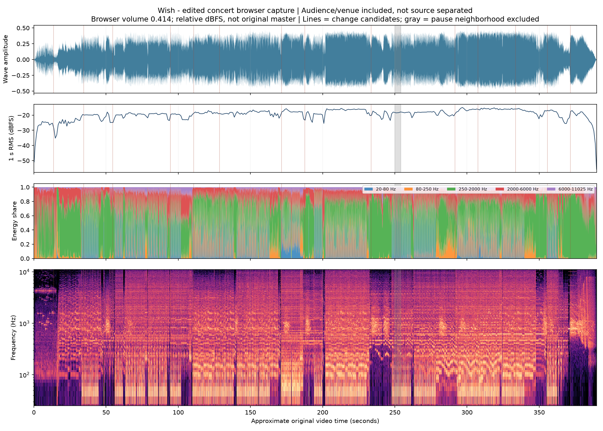
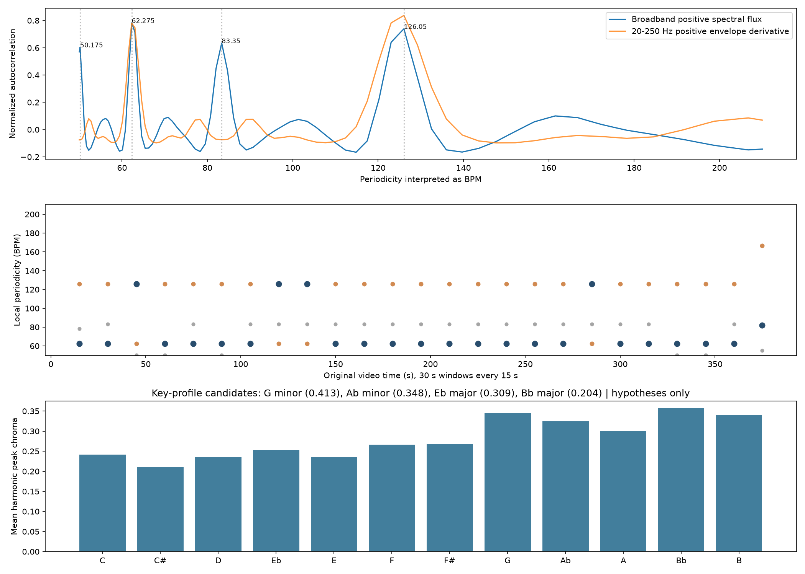

# 19:30 · 「Wish」 분석과 제작 기록

TLDR; 문헌·실제 녹음 분석은 아래에 보존했어요. 지금까지 에이전트가 생성한 후보는 모두 탈락했으며, 현재 기준은 **바탕의 8비트·16비트 선율을 전곡에서 아주 단순하게 남기고 층과 힘만 키우는 것**이에요.

- 문헌 조사·녹음: 2026-10-25 KST. 최신 사용자 판정 기록: 2026-10-26 KST.
- 기준: [사용자 지정 KIRARA 「Wish」 영상](https://www.youtube.com/watch?v=FQ-8bQbPSaY), 영상 길이 **6:29.701**.
- 기존 문헌과 아래 원시 측정 수치는 바꾸지 않았다. 직접 오디오 입력을 통한 청음은 지원되지 않았다.

## 현재 사용자 판정과 보존 기준

사용자는 “베이스에 깔린 8bit-16bit 베이스 멜로디가 너무 복잡해. 아주 단순한 멜로디여야해. 탈락”이라고 판정했다. 이어 “지금까지는 아래가 제일 유사한 편이야.”라며 제공한 원문을 [00_user-preferred-reference.txt](../input/tracks/00_user-preferred-reference.txt)에 그대로 보존했다. 이 원문은 사용자 청취 선호이며 원곡의 확정 채보가 아니다.

같은 음높이 하나의 8마디 도입 뒤 조용한 베이스와 두 번째 음색이 따로 들어오고, 단순하고 깊이 슬픈 중심 선율이 펼쳐지는 흐름이 현재 기준이다. 후반에도 바탕 선율을 복잡하게 만들지 않고 악기층·화음·드럼의 힘으로 키운다. 관객 소리와 보컬은 목표에 넣지 않는다.

v1·v2·「A Light Left On」의 에이전트 생성 후보는 모두 탈락했다. “네가 만든건 지웠어.”는 사용자 삭제 보고다. 추가 생성·복원·재생성은 하지 않으며 채택된 최종 음원은 없다. 외부·사용자 후보는 에이전트 생성물이 아니고, 원문과의 생성 입력 연결도 미확정이다. 기존 실행 프롬프트와 생성 기록은 그대로 보존한다. 아래 문헌 기반 제작 제안은 그 당시의 분석 이력이며 최신 선호 원문을 대체하지 않는다.

## 1. 음악의 중심은 “같은 쉬운 선율이 달라져 돌아오는 것”

### 선율과 작곡 순서

키라라는 대전행 KTX에서 중심 멜로디(귀로 따라 부를 수 있는 가락)를 먼저 만든 뒤 좋아하는 코드(함께 울리는 음의 묶음)를 얹었다고 설명한다. CJ문화재단 소개도 친구들의 행복과 안녕을 바라며 그들에게 닿을 만큼 쉽게 부를 선율을 만들었다고 명시한다. 기억하기 쉬운 훅(곡을 알아보게 하는 짧은 선율)이 먼저 있고, 편곡(그 선율을 여러 소리로 꾸미는 방법)이 그 훅을 확장하는 곡이다. [창작자 인터뷰](https://brunch.co.kr/@susuhan/107), [CJ문화재단](https://www.cjazit.org/support/tune-up/entry/64/26725?p=35).

새 곡에서도 주인공은 **새로 만든 단순한 신스(전자적으로 만든 악기 소리) 훅 하나**다. 같은 훅을 다른 소리·받침 화음·박자 문맥으로 돌아오게 한다. 원곡의 정확한 선율을 복사하라는 지시는 넣지 않는다. 빠른 음이나 다른 선율을 계속 추가해 중심이 사라지는 편곡도 피한다.

### 가벼운 디지털 도입과 넓어지는 소리

사용자가 짚은 게임 같은 가벼움은 얇고 단순한 디지털 음색, 적은 반주와 여백이라는 제작 언어로 남긴다. 나중에는 둥근 화음과 단단한 저음, 무거운 드럼으로 같은 선율의 몸집을 키운다. 이는 실제 8비트·16비트 기기나 특정 파형을 확인했다는 뜻이 아니다.

Korean Indie는 「Wish」를 멜로디 중심 전자음악과 초기 《cts》 계열 감각의 조합으로 설명한다. 같은 글에서 게임 *Lumines*를 떠올린다고 한 곡은 「Blink」와 「Earthquake」다. 그 설명을 「Wish」의 장비 근거로 옮기지 않는다. [Korean Indie 평론](https://www.koreanindie.com/2018/10/22/kirara-%ED%82%A4%EB%9D%BC%EB%9D%BC-sarah/).

### 드럼: 훅을 더 선명하게 만드는 추진력

나원영의 곡별 해설은 빅비트(킥과 스네어의 강한 타격을 중심으로 달리는 전자음악 리듬)식 드럼의 정확하고 강한 진입이 선율을 강조한다고 설명한다. 킥(낮고 둥근 북소리)과 스네어(짧고 날카롭게 치는 북소리)의 힘이 여린 선율을 떠받친다. [유통사 게재 앨범 해설](https://music.bugs.co.kr/album/20185527).

제작에서는 도입부터 완성된 드럼을 모두 쓰지 않고, 훅이 먼저 보이도록 둔다. 뒤에 드럼을 크게 넣어도 선율은 애틋하게 남긴다. 모든 구간을 같은 패턴으로 고정하거나, 자료가 필수로 지목하지 않은 `electro-house`를 중심 장르로 강제하지 않는다.

### 베이스와 중반의 불안

같은 해설은 중반 브리지(앞뒤의 큰 구간 사이에서 분위기를 바꾸는 부분)의 불안하게 들끓는 저음을 따로 짚는다. 베이스(음악의 낮은 중심을 받치는 소리)가 언제나 같은 역할을 하는 것이 아니다. 평소에는 춤출 수 있는 바닥이 되고, 소리를 걷어낸 순간에는 긴장으로 남는다. [같은 앨범 해설](https://music.bugs.co.kr/album/20185527).

실측에도 **저음은 커지지만 위쪽의 밝기와 타격 변화량은 줄어드는 구간**이 있다. 따라서 “계속 더 많은 소리를 추가”하기보다, 저음을 중심으로 한 번 무게를 바꾸는 설계가 어울린다. 문헌의 브리지가 라이브의 정확히 어느 구간인지는 별도 확정하지 않는다.

### 록의 힘: 기타의 양보다 리프와 치고 빠짐

키라라는 DTSQ 공연에서 기타 리프(짧은 음형을 되풀이해 곡을 밀어가는 연주)의 전진하는 힘, 달리는 느낌과 잠깐 치고 빠지는 방식을 얻었다고 직접 설명한다. 중간의 기타 리프도 언급하며 전체 편곡에는 80 Kidz의 영향을 밝혔다. [창작자 인터뷰](https://brunch.co.kr/@susuhan/107).

이를 새 곡에서는 짧게 솟는 기타 같은 리프, 순간적인 비움, 힘 있게 되들어오는 드럼으로 옮긴다. 곡 전체를 거친 왜곡 소리로 덮거나 긴 기타 독주로 중심 훅을 대체하는 지시는 넣지 않는다. 공개 설명만으로 실제 기타 녹음·샘플·합성음 중 어느 방식인지는 구별할 수 없다.

### 후반의 화음은 관객 목소리가 아니라 악기로 만든다

곡별 해설은 하나의 멜로디가 다른 톤·조·리듬을 통과하고, 후반에는 함께 따라 부르는 듯 화음이 쌓인다고 설명한다. 제작 지시의 `stacked instrumental harmonies`는 **악기 화음을 겹치는 것**이다. 관객 떼창·합창 보컬은 넣지 않는다. [앨범 해설](https://music.bugs.co.kr/album/20185527).

훅 위아래의 음역(소리가 높고 낮게 뻗는 범위)을 넓히되 원래 중심이 계속 들리게 한다. 아르페지오(화음의 음을 차례로 펼쳐 연주함)나 대선율(중심 선율 옆에서 함께 움직이는 다른 선율)은 필요한 만큼만 선택한다. 여러 선율이 많아져야 닮는 곡으로 해석하지 않는다.

### 왜 “신나지만 슬픈가”

문헌을 합친 해석은 **선율의 연약함은 남고, 그 선율을 받치는 힘이 커진다**는 것이다. 쉬운 선율의 반복은 익숙함을 만들고, 그 밑의 화음과 소리 변화는 같은 선율을 다르게 느끼게 한다. 강한 드럼은 몸을 움직이게 하지만 훅이 애틋하게 남으면 밝은 축제 음악으로 완전히 바뀌지 않는다.

잠깐 소리를 덜어낸 뒤 돌아오면 같은 훅도 더 크게 느껴질 수 있다. 마지막의 악기 화음은 그 훅의 공간을 넓힌다. 친구를 잃은 슬픔과 다른 친구들의 안녕을 바라는 창작 배경도 이 정서와 맞닿는다. 이는 인터뷰·곡 소개·평론을 합친 해석이며, 관객 환호나 특정 코드 하나가 감정을 증명한다는 뜻은 아니다. [창작자 인터뷰](https://brunch.co.kr/@susuhan/107), [CJ문화재단](https://www.cjazit.org/support/tune-up/entry/64/26725?p=35).

## 2. 브라우저(웹페이지를 여는 앱) 녹음으로 별도 확인한 파형과 특징

아래는 실제 녹음의 신호(소리를 수치로 바꾼 자료) 분석이다. 문헌의 구간명을 붙인 청음표가 아니다. 관객과 공연장 소리는 섞여 있으므로, 음악만 분리한 악기층·화음 판정으로 쓰지 않는다.

위에서부터 파형(시간에 따른 진폭 그림), 1초 평균 크기, 낮은 소리부터 높은 소리까지의 비중, 스펙트로그램(시간에 따라 어떤 높이의 소리가 있는지 그린 그림)이다. 회색 구간은 일시정지 부근으로 분석에서 제외했다.

### 속도: 약 125 BPM을 여러 방식이 지지한다

- 저음의 반복 간격을 주파수 방식으로 분석한 가장 큰 후보는 **125.146 BPM**이었다. 앞·중간·뒤를 각각 독립 계산해도 이 후보가 가장 컸다.
- 전체 소리의 같은 방식 후보는 124.121·125.146 BPM이었다. 자기상관(소리를 시간차를 두고 겹쳐 반복 간격을 찾음)은 126.05 BPM과 절반 속도인 약 62.3 BPM 부근도 강하게 표시했다.
- 서로 다른 방식이 약 125 BPM 부근을 지지한다. 62 BPM 후보는 반속도 해석과 함께 남기며 곡 중간에 실제 속도가 절반으로 바뀌었다고 해석하지 않는다. 공개 발매 음원의 자동분석 125 BPM과도 맞는다.
- 새 곡의 목표는 **125 BPM·4/4(한 마디에 네 박)**이다. 4/4는 공개 분석을 참고한 제작 선택이며, 반복 간격 분석만으로 박자표를 인증한 결과는 아니다.

### 전체 크기와 소리 분포

Hz(1초 동안 소리가 떨리는 횟수)는 낮은 소리와 높은 소리를 나누는 단위다.

| 실측 항목 | 결과 | 음악적으로 읽을 수 있는 범위 |
|---|---|---|
| 분석 대상 | 48,000Hz·좌우 두 채널 녹음을 평균해 22,050Hz 한 채널로 변환 | 아래 음량·음역 수치는 이 분석본의 값 |
| 전체 RMS(일정 시간 소리 크기의 평균) | -18.57 dBFS(디지털 최대값을 0으로 둔 상대 크기) | 재생 음량이 반영된 녹음값. 원래 발매 음원의 최종 크기는 아님 |
| 1초 RMS의 가운데 80% | -24.22~ -16.17 dBFS, 차이 약 **8.05dB** | 전체가 같은 크기로 고정되지 않았음을 보여줌 |
| 분석본 순간 최고값 | -6.10 dBFS | 원시 좌우 채널의 최고값 -4.84 dBFS와는 측정 대상이 다름 |
| 20~250Hz 저음 비중 | **43.2%** | 저음의 무게가 큰 녹음. 공연장 울림도 포함 |
| 250~2,000Hz 중간 비중 | **39.7%** | 선율·화음·관객 음성 등이 겹치는 영역 |
| 2,000~11,025Hz 위쪽 비중 | **17.1%** | 밝기·타격·관객 박수 등을 함께 포함 |

위 비중을 새 곡의 고정 음향 설정으로 복사하지 않는다. 인터뷰의 “큰 음압(귀에 닿는 소리의 압력)과 강한 고역(높은 음역)”이라는 작가 취향과 라이브 녹음의 수치는 서로 다른 종류의 근거다.

### 6:29.701 전체의 변화 지도

변화 지점은 음량·음역 분포 등의 차이로 얻은 **음향 변화 후보**다. 아래 시각은 원영상 시간에 맞춘 근사값이다. 경계가 정확한 마디 시작이나 악기 교체 시각이라는 뜻은 아니다.

- 저음 비중: 각 구간의 20~250Hz 비중.
- 밝기 중심: 스펙트럴 센트로이드(소리의 무게가 어느 높이에 모이는지 나타내는 값), 단위 Hz.
- 타격 변화: 전체 녹음 기준으로 정규화한(값의 범위를 맞춘) 시작 변화량. **악기 수나 실제 음표 수가 아니다.**

| 원영상 구간 | 평균 크기 dBFS | 저음 비중 | 밝기 중심 Hz | 타격 변화 |
|---|---:|---:|---:|---:|
| 00:00.0–00:13.5 | -26.35 | 8.3% | 3067 | 0.058 |
| 00:13.5–00:34.5 | -24.01 | 10.2% | 2390 | 0.061 |
| 00:34.5–00:54.5 | -20.58 | 22.4% | 2497 | 0.166 |
| 00:54.5–01:34.5 | -19.69 | 37.1% | 3380 | 0.202 |
| 01:34.5–01:50.5 | -20.52 | 24.9% | 3760 | 0.212 |
| 01:50.5–02:08.5 | -18.36 | 49.1% | 2174 | 0.081 |
| 02:08.5–02:51.5 | -18.52 | 39.2% | 2867 | 0.218 |
| 02:51.5–03:07.5 | -17.61 | 49.8% | 3357 | 0.242 |
| 03:07.5–03:53.5 | -17.30 | 36.4% | 2994 | 0.167 |
| 03:53.5–04:51.5 | -18.67 | 24.2% | 2856 | 0.260 |
| 04:51.5–05:07.5 | -16.40 | 42.9% | 3221 | 0.184 |
| 05:07.5–05:33.5 | -15.93 | 40.1% | 3246 | 0.178 |
| 05:33.5–05:55.5 | -17.61 | 20.5% | 2920 | 0.146 |
| 05:55.5–06:11.5 | -19.28 | 22.4% | 2841 | 0.167 |
| 06:11.5–06:29.7 | -20.14 | 0.7% | 2938 | 0.164 |

문헌과 프롬프트를 연결할 때는 아래 **일곱 전환 후보**가 중요하다. 숫자는 경계 직전 8초와 직후 8초의 비교다. 오른쪽은 그 대비를 새 곡에 옮기는 제작 제안이며, 관객을 분리한 악기 판정은 아니다.

| 원영상 부근 | 녹음에서 확인한 변화 | 「아직 여기」에서 살릴 움직임 |
|---|---|---|
| **00:34.5** | 저음 세기 +5.8dB, 초당 타격 후보 1.625→4.125 | 가벼운 훅을 보여준 뒤 드럼과 저음의 무게를 붙임 |
| **01:50.5** | 저음 +6.7dB·고음 -2.2dB, 밝기 중심 3,857→2,133Hz | 위쪽 소리를 덜고 낮은 긴장을 남김. “더 크게”와 다른 방향의 변화 |
| **03:07.5** | 저음 -5.3dB·고음 -3.7dB, 타격 후보 6.375→2.125 | 달리던 흐름을 잠시 덜어 다음 귀환의 여백을 만듦 |
| **03:53.5** | 저음 -21.4dB, 저음 비중 34.7→0.6% | 바닥을 과감히 걷어내 훅 또는 남은 소리가 드러나는 대비 |
| **04:51.5** | 저음 +5.3dB·고음 +2.4dB, 타격 후보는 7.375→4.625 | 변화 횟수만 늘리지 않고 화음과 저음의 몸집으로 크게 돌아옴 |
| **05:55.5** | 저음 +10.1dB·고음 +3.5dB, 타격 후보 2.000→4.875 | 후반에도 짧은 비움 뒤 힘 있는 재진입을 남김 |
| **06:11.5** | 저음 -31.9dB, 타격 후보 3.625→1.000 | 마무리에서는 무게를 덜어냄. 관객 소리 때문에 실제 연주 종료 시각은 확정하지 않음 |

전체 구간 평균으로 보면 도입의 저음은 약 8~10%, 00:54.5 이후에는 약 37%이고 01:50.5~02:08.5에는 약 49%다. 05:07.5~05:33.5의 평균 크기는 -15.93dBFS로 도입보다 약 10.42dB 높다. 그러나 중간의 여러 감소와 재진입이 있어, 처음부터 끝까지 같은 방향으로 쌓는 방식으로 요약하면 중요한 대비를 놓친다.

이 지도는 첫 번째 분석의 **한 훅 → 다른 질감과 무게 → 긴장과 비움 → 더 큰 귀환**을 구체적인 제작 구조로 옮길 근거가 된다. 다만 “기타가 00:54.5에 들어온다”처럼 실측으로 확인하지 못한 악기 배치는 만들지 않는다.

## 3. 화성은 후보와 제작 선택을 나눠 쓴다

### 공개 코드 후보

공개 자동 채보(소리에서 음과 화음을 기계로 추정함)에는 `A♭ → A♭m → E♭/G → Cm`과 C·C7·G 계열 변형이 있다. **다른 스튜디오 소스 영상 `miFQ4fpkLTc`를 대상으로 한 Chordify 후보**이며 지정 라이브의 정확한 진행·마디·전위(같은 화음에서 가장 낮은 음을 바꿈)를 확정한 결과가 아니다. [Chordify](https://chordify.net/chords/kirara-songs/wish-chords).

음악 이론상 A♭→A♭m이면 C가 C♭로 반음 내려간다. E♭장조 문맥에서는 IV→iv로, 밝은 화음에 같은 뿌리의 어두운 색을 잠깐 빌리는 차용화음(다른 장·단조의 화음을 잠깐 사용함)이다. 이어 E♭/G로 가까운 음끼리 연결하면 애틋한 변화를 만들 수 있다. **이 설명은 후보가 낼 수 있는 효과**이며 원음을 채보했다는 증거는 아니다.

### 실제 녹음의 조성 후보

녹음의 크로마(높이가 다른 음을 도·레·미 같은 음 이름별로 모은 분포)를 일반적인 장·단조 형태와 비교하면 G minor 0.413, A♭ minor 0.348, E♭ major 0.309가 상위 후보였다. 구간마다 순위도 바뀐다. 공개 서비스의 E♭ major·C minor 판정과 일치하는 단일 결론이 나오지 않는다. 약한 유사도와 공연장 울림·배음(한 음 위에 함께 생기는 높은 소리)의 영향을 고려해 키(음악이 돌아와 쉬는 중심음)와 정확한 코드는 미확정으로 남긴다.

새 곡에서는 **E♭ major를 제작용으로 선택**한다. 밝은 바탕 위에서 장·단화음의 색이 기울어지는 `bittersweet major-to-minor colors`를 요청한다. 미확인 원곡 코드명을 강제하는 대신, 슬픔과 밝음이 함께 남는 효과를 새 화음으로 재해석한다.

## 4. 「아직 여기」: 무엇을 남기고 무엇을 새로 만드는가

| 원곡에서 남길 성격 | 근거 | 새 곡에 넣은 생성 지시 |
|---|---|---|
| 쉬운 중심 선율 하나 | 곡 소개·작곡 순서 | `An original memorable synth hook` — 새로 만든 한 훅을 계속 알아볼 수 있게 |
| 신나는 드럼과 애틋한 선율 | 곡별 해설·창작 배경 | `punchy big-beat drums` / `Keep the melody wistful at peak energy` |
| 가벼운 시작에서 저음·타격 확대 | 사용자 감각 + 00:34.5·00:54.5의 실측 변화 | `thin chip-like digital motif and sparse accompaniment` 뒤에 베이스·화음·드럼 추가 |
| 같은 훅의 문맥 변화 | 곡별 해설 + 크기·밝기·저음이 서로 다르게 움직이는 실측 | `Transform the SAME new hook through changing timbres, harmonies and rhythmic settings` |
| 록 같은 전진과 치고 빠짐 | 직접 인터뷰·곡별 해설 | `Short rising guitar-like riffs and stop-start gaps` |
| 낮아지는 긴장과 큰 귀환 | 중반 저음·후반 화음에 대한 해설 + 실측의 대비 | `uneasy low-bass bridge` 뒤 `stacked instrumental harmonies` |
| 처음부터 끝까지 커지기만 하지 않음 | 파형·구간별 크기와 음역 변화 | `Alternate accumulation, subtraction and forceful re-entry` |
| 원래의 슬픈 감정을 마지막까지 남김 | 창작 배경·곡별 해설 | 마지막에도 훅은 애틋하게, 가장 큰 악기층은 마지막 귀환에 |
| 관객 없이 정돈된 연주곡 | 사용자 명시 조건 | 공연장의 환호·박수·따라 부르기·방 울림을 제외 |

새로운 것은 중심 선율과 그 음표, 실제 화음 배치다. 남기는 것은 빅비트의 추진력, 여린 정서, 긴 호흡의 전개와 비움·재진입의 관계다. 제목 「아직 여기」는 새 곡에 제안한 제목이다.

### 믹스와 공간의 방향

믹스(여러 악기의 크기와 위치를 조절해 함께 들리게 만드는 작업)는 선명한 상단 선율과 무거운 드럼을 함께 둔다. 리버브(소리가 공간에 남는 잔향)를 과하게 만들어 훅을 흐리지 않는다. 공연의 스테레오(좌우 두 채널에 소리를 배치하는 방식) 울림이나 관객이 주는 에너지를 새 곡의 악기 소리로 복제하지 않는다. 목표는 정돈된 스튜디오(현장 소음을 넣지 않고 제작하는 녹음 환경) 사운드다.

## 5. Suno 입력과 사용 방법

제작용 전체 입력은 [01_아직여기.txt](../input/tracks/01_아직여기.txt)에 저장한다. Style(생성할 음악의 성격을 적는 입력)과 Exclude(빼고 싶은 요소를 적는 입력)는 그 파일이 기준이다. Instrumental(악기만 연주하도록 고르는 설정)을 켜며 LYRICS에는 `[Instrumental]`만 둔다.

- **Style 900자 이하·Exclude 8개 이하**는 Wavvy 내부 편집 기준이다. Suno의 공식 제품 한도라는 뜻은 아니다.
- 실제 계정의 모델(음악을 만드는 생성기 종류)·옵션·생성 후보는 제출 담당이 관측한 값으로 따로 기록한다. 이 보고서가 특정 모델을 사용했다고 대신 확정하지 않는다.
- 약 6분은 도입·긴장·후반 귀환을 서둘러 합치지 않기 위한 목표다. 생성 길이와 구간 시각은 생성된 음원으로 확인한다.
- 첫 후보는 새로운 훅이 들리는지, 도입이 가벼운지, 중간에 밀도를 덜어내는지, 후반 화음이 커져도 애틋함이 남는지, 보컬·관객 소리가 없는지로 확인한다.

실제 01 txt의 자동 입력 계약 검사는 PASS이며, Style은 공백 포함 888자·Exclude는 8개·가사 입력은 `[Instrumental]`이다. [원시 검사 출력](../../../.ai/research/2026-10-25-1930-wish/track-prompt-gate.json)을 보존한다. 이는 입력 형식을 확인한 결과이며 음악의 유사도나 청취 품질을 인증하지 않는다.

사용자가 연구·녹음 분석을 바탕으로 비슷하지만 재해석한 곡을 만들어 달라고 요청했으므로 이번 한 곡의 첫 생성을 위한 입력이다. 이 문서가 후보 청취·채택 결과를 대신하지 않는다. 입력 기능 근거: [Suno Instrumental 안내](https://help.suno.com/en/articles/6882817), [Exclude 안내](https://help.suno.com/en/articles/3161921), [Style 설명](https://help.suno.com/en/articles/13924481).

## 부록 A. 근거와 한계

| 구분 | 확인 범위 | 남은 한계 |
|---|---|---|
| 창작·곡 해설 | 작곡 순서, 쉬운 선율, 록 영향, 빅비트, 중반 저음, 후반 화음 | 라이브의 각 악기가 들어오는 정확한 시각·장비·연주법은 설명하지 않음 |
| 실제 녹음 수치 | 전체 길이, 반복 간격, 상대 음량, 음역 비중과 변화 후보 | 직접 청음·음표 채보·악기 분리는 수행하지 못함 |
| 관객 소리 | 생성 목표와 작곡 해석에서 제외 | 녹음에서 소리를 분리·제거하지 않았으므로 수치에는 섞임 |
| 조성·코드 | 외부 자동 채보 후보와 이번 녹음의 후보를 별도로 확인 | 원곡 확정 키·정확 코드·코드 전위는 미확정 |
| 디지털 질감 | 사용자 감각을 생성 지시로 번역 | 8비트·16비트 기기, 펄스파·사각파, 악기 모델은 미확정 |
| 믹스 | 녹음의 상대 수치와 창작자의 일반 취향 | 원래 음원의 압축량·잔향 설정·최종 음압을 복원하지 못함 |

현재 모델에 오디오를 직접 입력하는 경로는 지원되지 않았다. “직접 듣고 확인했다”는 청음 결과를 만들지 않는다. 글에 나온 악기 이름은 문헌 설명 또는 제작 제안이며, 주파수 분석만으로 확정한 악기 목록이 아니다.

첫 번째 전달 GPT 분석의 중심축인 **한 훅의 변화·빅비트·중반 저음·후반 화음·치고 빠짐**을 남겼다. 두 번째 분석의 `electro-house`, 여러 대선율, 특정 파형·음형은 선택 아이디어로만 다뤘다. 전달 원문 Style은 990자·985자, Exclude는 11개·12개여서 이번 입력은 내부 예산에 맞춰 편집했다.

## 부록 B. 녹음 경로와 시간 정렬

- 경로: 사용자 지정 Aside 브라우저를 실제 재생하고, ScreenCaptureKit(앱에서 나오는 소리를 받는 macOS 기능)으로 Aside 앱 소리만 48,000Hz·좌우 두 채널로 녹음했다. 마이크는 받지 않았다. 탭 하나만 분리한 캡처는 아니다.
- 영상은 재생속도 1, 음소거 해제, 브라우저 볼륨 약 0.414 상태였고, 0초 부근부터 389.701초의 자연 종료까지 기록했다. 녹음 버퍼(소리를 잠시 담아 저장하는 묶음) 21,783개의 시간 연결에 1샘플(소리를 저장하는 최소 한 칸) 초과의 누락은 없었다.
- 원시 녹음은 435.66초다. 실제 분석 파생본은 녹음 전후 여분과 일시정지 중의 정확한 0 신호 0.787396초를 덜어낸 **390.216833초**다. 영상보다 0.515833초 길며, 영상과 소리 출력의 지연은 정밀 보정하지 않아 시작 정렬에 약 0.67초 미만의 불확실성이 있다.
- 04:12.025 부근에서 약 0.792초의 pause/play 사건이 있었다. 외부 원인은 확정하지 않는다. 분석은 원영상 **04:10.025~04:14.248**을 제외하고, 앞뒤를 별도로 시간 정렬했다. 이 부근을 곡의 의도된 비움이나 리듬 중단으로 해석하지 않는다.
- 원시 녹음과 편집 기록을 보존했다. 관객 제거·잔향 제거·음량 정규화는 하지 않았다. 수치상 연결부의 급격한 점프는 0이지만, 귀로 클릭음을 검증했다고 주장하지 않는다.

원시 녹음 SHA-256(파일 내용이 바뀌었는지 확인하는 지문): `9e6c5885e2bcfe6a481e5a53d088220b51b5262c5e5464c5b8ea45de7dcb219d`. 분석 파생본: `3c5f7c560115682be1e42893d6ea807c5afdd22dc5bc5c75a0b01593a49380f8`.

## 부록 C. 버전과 출처

| 대상 | 확인한 정보 |
|---|---|
| 2018년 《Sarah》 | 2018-08-11 발매, 「Wish」 2번 트랙, 공식 표기 5:55, 작곡·편곡·믹스 KIRARA. [공식 Bandcamp](https://stqpkiraradongjae.bandcamp.com/album/sarah) |
| 2020·2025 재유통 | 2020-10-29 리마스터(기존 음원을 다시 다듬음)를 2025년 재유통에 사용했다는 설명. [Bugs](https://music.bugs.co.kr/album/20185527) |
| 지정 라이브 | 제목상 2026-04-11 공연, 2026-04-29 게시. 이번 녹음 기준. [YouTube](https://www.youtube.com/watch?v=FQ-8bQbPSaY) |
| 별도 2026년 발매 | DJ용 7:45·드러머용 5:56이며 지정 라이브와 다른 버전. [공식 Bandcamp](https://stqpkiraradongjae.bandcamp.com/album/wish) |

Brunch와 Artinsight는 같은 인터뷰이며, Bugs와 MUSIC&NEW는 같은 나원영 해설이다. 페이지 수를 독립적인 분석 수로 세지 않는다. 검증하지 못한 Shazam의 속도나 출처 불명 A♭ major 판정을 추가하지 않는다.

- [사용자 원본 요청과 추가 지시](../../../.ai/research/2026-10-25-1930-wish/request.md)
- [사용자가 전달한 두 GPT 분석](../../../.ai/research/2026-10-25-1930-wish/user-gpt-analyses-source.md)
- [공개 자료 본문 확인 기록](../../../.ai/research/2026-10-25-1930-wish/web-research.md)
- [실제 녹음 분석 보고서](../../../.ai/research/2026-10-25-1930-wish/audio-analysis.md)
- [실측 수치](../../../.ai/research/2026-10-25-1930-wish/signal-analysis.json) · [녹음 검증](../../../.ai/research/2026-10-25-1930-wish/capture-verification.json) · [편집 기록](../../../.ai/research/2026-10-25-1930-wish/edit-manifest.json)
- [별도 파형·주파수 그림](../../../.ai/research/2026-10-25-1930-wish/waveform-spectrogram-features.png)

선례: [17:30 공개 사례 연구](../../../.ai/research/2026-10-22-1730-title/research.md)의 관측·출처·한계 분리. 입력 기준: `MASTER/WORKFLOWS.md` §0–1, `MASTER/style/STYLE.md`, `MASTER/lyrics/LYRICS.md`. 기존 참고 파일은 미채택 `reference-study`이며, 실제 새 곡 입력과 구분한다.
